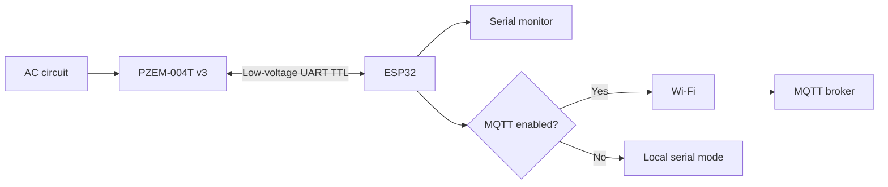

# Smart Home Energy Meter
### ESP32 + PZEM-004T v3 + Optional MQTT

[](https://github.com/akashp9686-star/smart-home-energy-meter/actions/workflows/ci.yml)


A repository-first embedded systems project that documents and implements an ESP32-based energy-monitoring node. The firmware reads electrical parameters from a compatible PZEM-004T v3 module over UART and can optionally publish JSON telemetry to an MQTT broker.

> **Verification scope:** The latest recorded GitHub Actions run (#13) completed successfully, including both PlatformIO firmware configurations (MQTT disabled and enabled) and the Python sample-data tests. No physical ESP32/PZEM assembly, mains installation, calibration, reference-meter comparison, Wi-Fi field test or live MQTT broker test is claimed. Example CSV readings and JSON payload values are illustrative, not measured observations.

## Project objectives

- Read voltage, current, active power, accumulated energy, frequency and power factor.
- Use ESP32 hardware UART2 with configurable pins.
- Reject unavailable, non-finite and broadly implausible readings.
- Print valid measurements to the serial monitor.
- Optionally publish telemetry as JSON over MQTT.
- Keep Wi-Fi and broker credentials out of version control.
- Provide technical research, safety notes, traceability and repeatable CI checks.

## System overview



This is a logical block diagram, not an approved mains wiring diagram.

## Hardware and software

| Layer | Selection |
|---|---|
| Controller | ESP32 DevKit / ESP32-WROOM-32 class |
| Meter | Compatible PZEM-004T v3 module |
| Serial interface | ESP32 UART2, default RX GPIO16 / TX GPIO17 |
| Firmware | Arduino framework |
| Build system | PlatformIO |
| Optional telemetry | MQTT via PubSubClient |

Confirm the exact ESP32 board, PZEM revision, TTL interface requirements and pinout against the manufacturers' documentation before any physical wiring.

## Repository structure

```text
.
├── .github/workflows/ci.yml
├── docs/
│   ├── abstract.md
│   ├── architecture.md
│   ├── components.md
│   ├── data-format.md
│   ├── design-decisions.md
│   ├── evaluator-guide.md
│   ├── faq.md
│   ├── limitations.md
│   ├── methodology.md
│   ├── mqtt-setup.md
│   ├── project-report.md
│   ├── requirements-traceability.md
│   ├── results-template.md
│   ├── review-checklist.md
│   ├── safety.md
│   ├── technical-research.md
│   ├── testing.md
│   └── wiring.md
├── examples/sample_readings.csv
├── include/config.example.h
├── src/main.cpp
├── tests/test_sample_readings.py
├── .gitignore
├── LICENSE
├── platformio.ini
└── README.md
```

## Build locally

1. Install [PlatformIO Core](https://platformio.org/install/cli).
2. Clone this repository.
3. Copy `include/config.example.h` to `include/config.h`.
4. Keep `MQTT_ENABLED` set to `0` for the default local build, or configure private credentials and set it to `1`.
5. Run:

```bash
pio run
```

The actual `include/config.h` is ignored by Git. Never commit Wi-Fi or MQTT credentials.

## Automated verification

The latest recorded workflow run (#10) passed all steps:
- MQTT-disabled firmware compilation
- MQTT-enabled firmware compilation
- Python sample-data unit tests (2 tests)

[View latest workflow run #13](https://github.com/akashp9686-star/smart-home-energy-meter/actions/runs/45000368437) · [View all workflow runs](https://github.com/akashp9686-star/smart-home-energy-meter/actions)

A successful build verifies compilation for the configured PlatformIO target; it does not verify physical measurements, wiring, electrical safety, MQTT delivery or calibration.

## Safety notice

**AC mains voltage can cause fatal electric shock or fire.** This repository is not a DIY mains wiring guide. Mains-side installation, protective devices, conductor sizing, enclosure, earthing and inspection must be handled by a qualified electrician using the exact PZEM module documentation and applicable local requirements. Never connect mains voltage to ESP32 GPIO/UART pins. Never use a breadboard for mains wiring.

Read [docs/safety.md](docs/safety.md) before any hardware work.

## Documentation guide

- [Project report](docs/project-report.md)
- [Evaluator guide](docs/evaluator-guide.md)
- [Architecture](docs/architecture.md)
- [Technical research](docs/technical-research.md)
- [Design decisions](docs/design-decisions.md)
- [Requirements traceability](docs/requirements-traceability.md)
- [Wiring/interface notes](docs/wiring.md)
- [MQTT setup](docs/mqtt-setup.md)
- [Telemetry data format](docs/data-format.md)
- [Testing and verification](docs/testing.md)
- [Limitations](docs/limitations.md)
- [Results template](docs/results-template.md)
- [Safety](docs/safety.md)

## Project status

| Area | Status |
|---|---|
| Repository structure and documentation | Complete |
| Firmware source and PlatformIO target | Included |
| MQTT optional implementation | Included; both compile-time paths passed CI |
| Sample-data tests | Passed (2 tests) |
| Hosted firmware build | Passed — GitHub Actions run #13 |
| Physical sensor operation and calibration | Not performed |
| Mains installation and inspection | Not performed |
| Live MQTT delivery | Not performed |

## License

Released under the MIT License. See [LICENSE](LICENSE).
