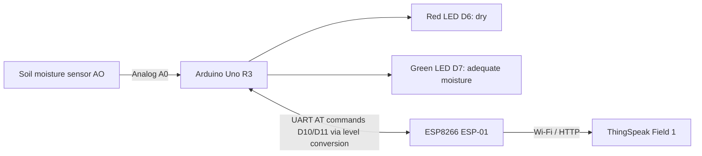

# System Architecture — Project 03

The Uno samples the analog soil sensor, maps the reading to a calibrated percentage and applies the 30% example threshold. The ESP-01 provides Wi-Fi using AT commands; the Uno initiates the ThingSpeak update. The two LEDs provide local status indication.
