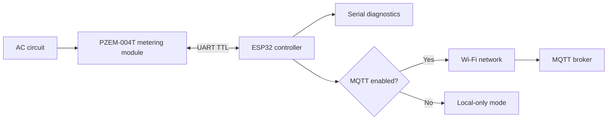

# System Architecture

## Data path
1. The PZEM module measures electrical parameters using its metering circuitry.
2. The ESP32 communicates with the module over UART2.
3. Firmware reads voltage, current, active power, accumulated energy, frequency and power factor.
4. Broad plausibility checks reject unavailable or out-of-range readings.
5. Valid values are printed to Serial Monitor.
6. If MQTT is enabled in the private local configuration, firmware serializes a JSON payload and publishes it to the configured topic.

The diagram is a logical architecture, not an approved mains wiring diagram.
