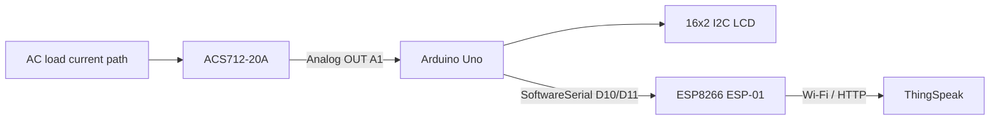

# Project 06 — System Architecture
Glowlogics handbook architecture: ACS712-20A senses current; Arduino Uno samples its analog output at A1 and estimates RMS current; the Uno calculates approximate apparent power using an assumed 230 V nominal supply; a 16x2 I2C LCD displays the values; an ESP8266 ESP-01 uses AT commands over SoftwareSerial to upload current and apparent-power fields to ThingSpeak.

The AC path is conceptual only. Qualified-person installation, isolation, enclosure and inspection are mandatory. Apparent power is an estimate (I x assumed 230 V), not measured active power.
